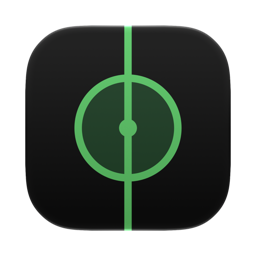
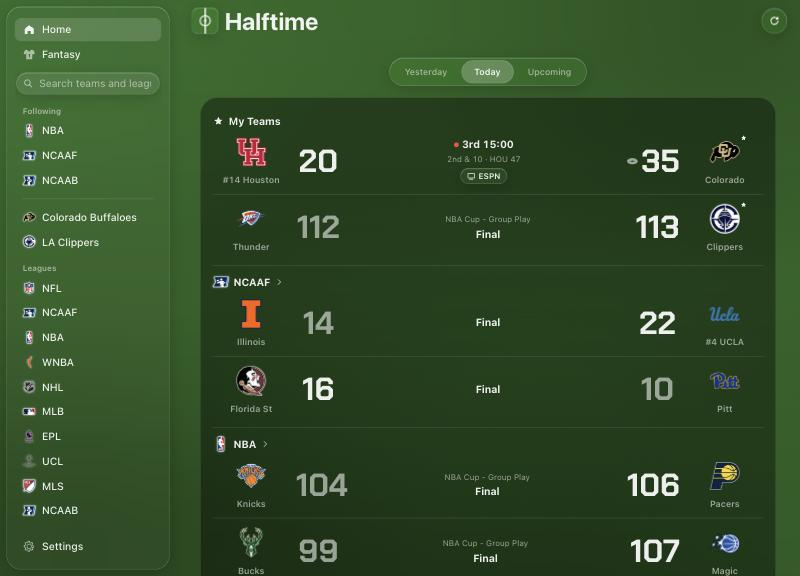
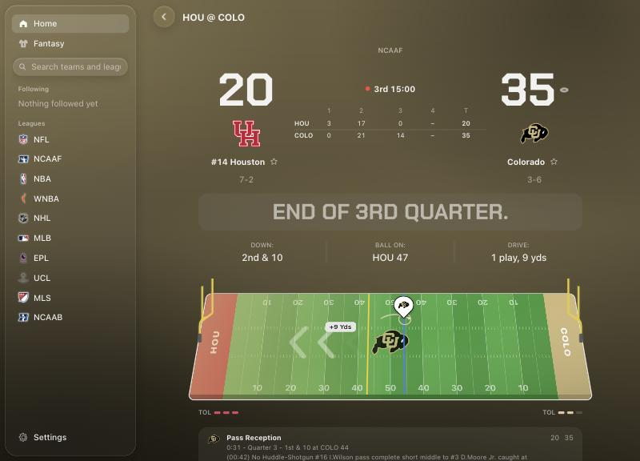
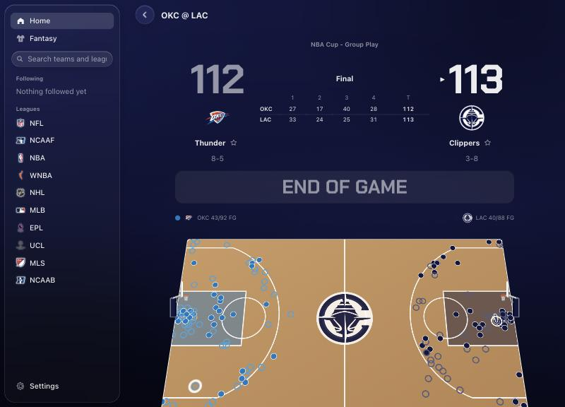
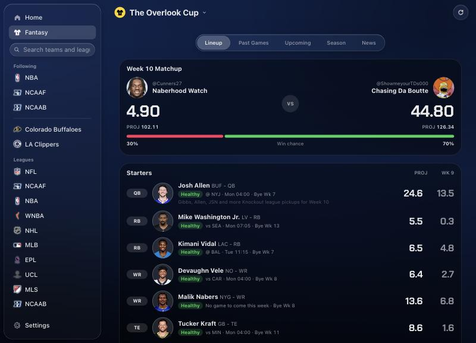
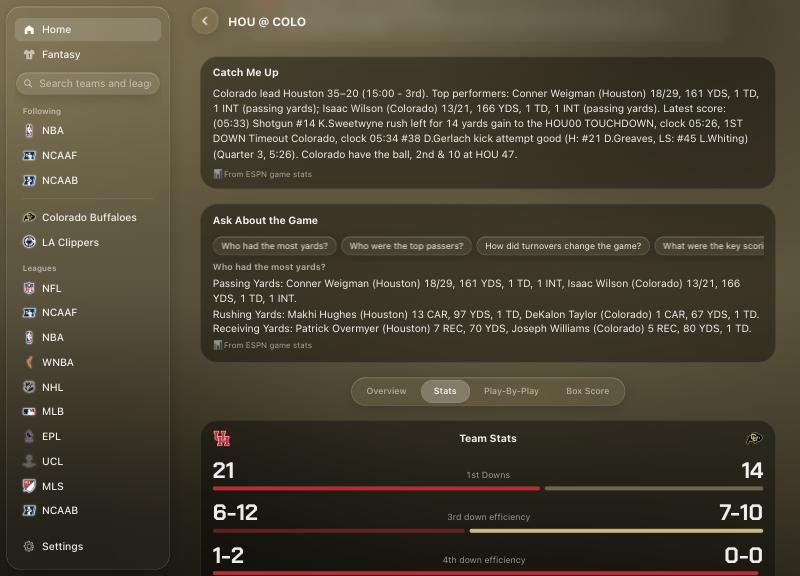

# Halftime

**Live scores, Gamecast and your fantasy team, right in your menu bar.**

&nbsp;&nbsp;

Free · Mac (Apple Silicon and Intel) and Windows 10/11 · [How to install](#install)

## Why Halftime

Halftime keeps every game you care about one glance away. It sits in your menu bar (the system tray on Windows)
with the score of whichever of your teams is playing, taps you on the shoulder when something happens, and opens
into a full game page with a live picture of the field or court. It covers the NFL, college football, the NBA, WNBA,
men's college basketball, MLB, the NHL, the Premier League, the Champions League and MLS.

## What it does

### Every game, live

Star the teams and leagues you follow and they come first on Home, in the menu bar and in your alerts. Scores update
every 15 seconds while games are on, and each card shows where to watch.

### Gamecast

Every game page draws the action as it happens: the ball moving down an ESPN-style field with the down, distance and
drive; a basketball court with every shot plotted; a hockey rink, a baseball diamond and a soccer pitch. Below that
are the line score, team stats, play-by-play, box scores and win probability charts.

&nbsp;

### Your fantasy team, everywhere

Connect a Sleeper league (just your username) or an ESPN Fantasy league. Halftime shows your matchup with a live win
chance, your lineup with injuries, byes and projections, past weeks with each player's stat line, your season's
trends and the standings. Your players get a yellow jersey badge on every NFL score card and in game pages, so you
always know who to cheer for.

### Claude, if you want it

Every game has a **Catch Me Up** card and **Ask About the Game**: quick answers to "who had the most yards?" come
straight from the stats. Add your own Anthropic API key and Claude writes the recaps, answers anything you ask about
the game, and briefs you on your fantasy week: matchup, lineup holes, injuries and the news behind them. Claude only
uses the game's real data, and your key stays in your Mac's Keychain (Credential Manager on Windows).

### Alerts that know what matters

Game start, every score, lead changes, the red zone, a close finish, overtime and the final. Turn each one on or off
for everything, per league or per team, mute a team, and set quiet hours so nothing buzzes overnight. Held alerts
arrive when quiet hours end.

## Install

**Mac.** Open `Halftime-Mac.dmg` and drag Halftime into Applications. Halftime isn't from the App Store, so the first
time you open it macOS says it can't check it: open **System Settings › Privacy & Security**, scroll down and click
**Open Anyway**. After that it opens like any other app.

**Windows.** Run `Halftime-Windows.exe`. If Windows SmartScreen says it protected your PC, click **More info ›
Run anyway**, then follow the installer.

Halftime lives in the menu bar or system tray. Close the window and it keeps running there, still sending alerts;
turn on **Launch at login** in Settings to have it start with your computer.

## Privacy

Scores come from ESPN and fantasy leagues from Sleeper and ESPN Fantasy. Halftime has no account and no server of its
own: your follows and settings stay on your computer, and your Claude key and any ESPN cookies are kept in your
system's secure store, sent only to Anthropic and ESPN.

## For developers

Halftime is built with [Tauri](https://tauri.app) and [SvelteKit](https://svelte.dev). The app lives in
[`web-prototype/`](web-prototype); see its README to run it, and [`HANDOFF.md`](HANDOFF.md) for how it's laid out.
Pushing a `v*` tag builds both installers and publishes them as a release.

Halftime is a personal project and isn't affiliated with or endorsed by ESPN, Sleeper, Anthropic or any league or
team. Team names and logos belong to their owners.
